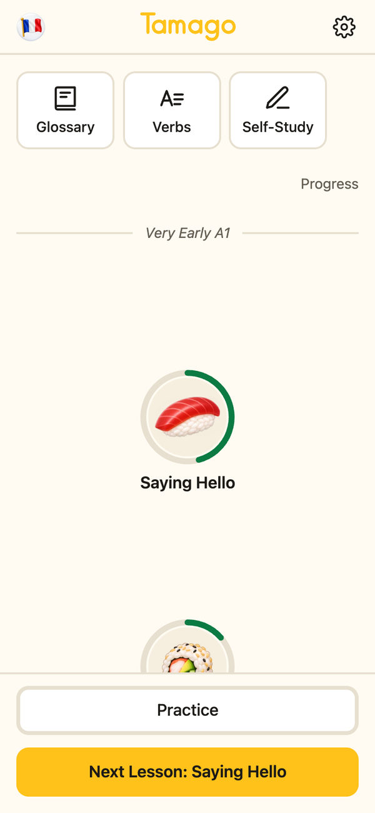
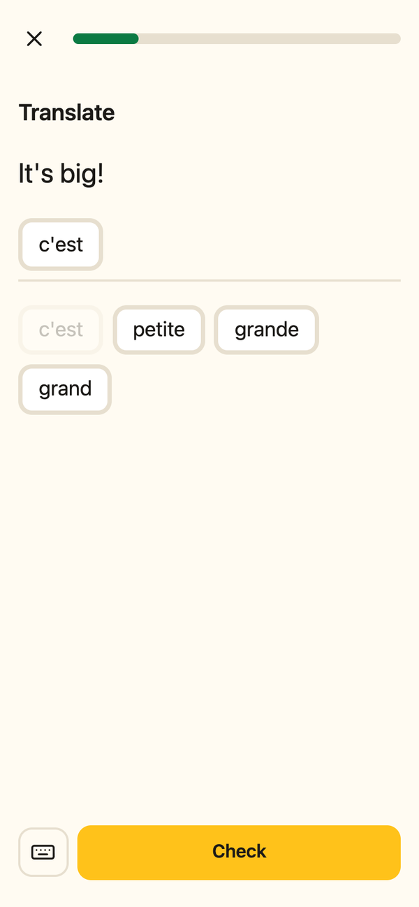
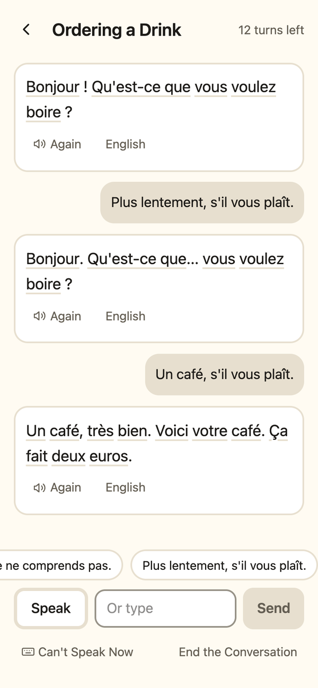

# Tamago

A small language-learning web app for English speakers: French, Latin American Spanish and German, from first words to CEFR A1. It installs to your phone's home screen and works offline. It has no account and no ads, and none of the usual game rewards: no hearts, gems or streak pressure.

**Live:** https://tamago-83f.pages.dev

<p>
  
  
  
</p>

## What it does

- **Short lessons on a path.** Each circle is a unit: about 30 sentences and its words, taught over five rounds. The rounds move from recognising to listening, then building, typing and speaking. A lesson is about ten minutes, and nothing slows the step from one question to the next.
- **Real sentences.** Sentences come from [Tatoeba](https://tatoeba.org), from owners who are native speakers, or that carry Tatoeba's OK tag. The few written for Tamago are marked and wait for a native speaker's check.
- **Meanings from Wiktionary, never from an AI.** Hints, parts of speech, genders and verb tables are read from [Wiktionary](https://en.wiktionary.org) and checked when the content is built.
- **Native recordings** from [Lingua Libre](https://lingualibre.org) where they exist, and the device's voice elsewhere.
- **Asking for help.** Three help circles in each course teach the phrases that keep a conversation going: "I don't understand", "slower, please", "what does … mean?", "I'm looking for the word…".
- **Conversations.** Short scenes with Claude, spoken or typed, and a conversation partner in Self-Study. Claude speaks a little above the learner's level on purpose, so asking for help is the practice. Never graded.
- **An A1 final check** for each course, modeled on the format of the DELF A1, DELE A1 and Goethe-Zertifikat A1: Start Deutsch 1. It uses only the course's own sentences.
- **Accessible.** Built to WCAG 2.2 AA: every question type works with the keyboard alone, and it supports screen readers and reduced motion.

## Stack

- React 19, Vite and Tailwind CSS 4, as an installable web app (PWA) with a service worker. Progress lives in the browser's IndexedDB; there is no backend database.
- Hosted on Cloudflare Pages. Two small Pages Functions call the Claude API, for explanations of mistakes, practice written from the learner's words, and conversations. They run on a key kept only as a Pages secret.
- The content pipeline is Node scripts. A workbook (one tab per table) is imported, checked against Tatoeba, Wiktionary and Lingua Libre, and built into JSON bundled with the app. The build fails if a check disagrees with the workbook.
- Spaced repetition with [ts-fsrs](https://github.com/open-spaced-repetition/ts-fsrs). Tests with `node --test`, plus Playwright and axe checks in the browser.

```sh
npm install
npm run dev        # the app at http://localhost:5173
npm test           # unit tests against the real content
npm run content    # import, check and build the French content (COURSE=es or COURSE=de for the others)
```

## How it was built

Tamago was built by Claude (Anthropic's model, in Claude Code) working from a written spec, with one person directing and checking.

- **Spec-driven.** The feature list, question-type logic, build phases and learning methods were written first (`_source/`). All content and setup data live in a versioned workbook, and every rule a lesson follows is a numbered row in it.
- **An autonomous build.** Claude worked through the build phases on its own under a written brief (`_source/autonomous-build.md`), testing, committing and deploying at the end of each phase. It kept a build log and a daily check-in, and stopped only for decisions that weren't its to make: money, accounts, going public, and the native-speaker check.
- **A separate AI reviewer.** A fresh Claude session with no build context reviews the live app against a fixed craft rubric (`_source/craft-review.md`), with screenshots. Its reports are in `_review/`, and their fixes feed the next round of work.
- **What each AI does, and under which rules,** is in the Model Story (`_source/model-story.md`).

## Credits and licenses

The **code** is under the [MIT License](LICENSE). The **content** keeps its own licenses:

| What | Source | License |
| --- | --- | --- |
| Sentences and their English translations | [Tatoeba](https://tatoeba.org) (each sentence's number and owner are listed in the app under Settings, About the Content) | [CC BY 2.0 FR](https://creativecommons.org/licenses/by/2.0/fr/deed.en) |
| Word meanings, hints, parts of speech, genders, verb tables | [Wiktionary](https://en.wiktionary.org) | [CC BY-SA 4.0](https://creativecommons.org/licenses/by-sa/4.0/) |
| Native recordings | [Lingua Libre](https://lingualibre.org), via Wikimedia Commons (each file's speaker and license is listed in the app) | Per file: CC BY-SA 4.0, CC BY-SA 3.0, CC BY 4.0 or CC0 |
| Sentences written for Tamago, and content built from the sources above | This project | [CC BY-SA 4.0](https://creativecommons.org/licenses/by-sa/4.0/) |
| Word pictures and sushi art | Made for Tamago | Not covered by the MIT License; all rights reserved |
| A few fallback pictures | [OpenMoji](https://openmoji.org) | [CC BY-SA 4.0](https://creativecommons.org/licenses/by-sa/4.0/) |
| CEFR self-assessment grid (`_source/reference/`) | Council of Europe, via Europass | © Council of Europe, included for reference only |

Tamago is an independent project, not affiliated with Tatoeba, Wiktionary, Lingua Libre, the Council of Europe or the bodies behind the DELF, DELE and Goethe exams.
